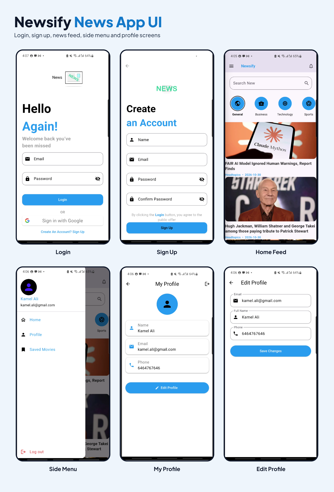

# News App

A Flutter news app that shows the latest headlines from NewsData.io, with search and a details screen. The UI is based on the Newsify design from Figma Community.

## Screenshots

## Features
- Home screen with trending news and categories
- Search news
- News details screen

## Tech Stack
- Flutter & Dart
- flutter_bloc (Cubit)
- dio (HTTP client)
- API: [NewsData.io](https://newsdata.io)

## Getting Started
1. Clone the repo:
   ```bash
   git clone https://github.com/KamelAli545/<repo-name>.git
   ```
2. Install dependencies:
   ```bash
   flutter pub get
   ```
3. Get a free API key from NewsData.io and add it to `ApiNews`. Do not commit your real key.
4. Run the app:
   ```bash
   flutter run
   ```

## Author
Kamel Ali Kamel · [LinkedIn](https://linkedin.com/in/kamel-ali03) · [GitHub](https://github.com/KamelAli545)
